# PlantCare

PlantCare is an offline indoor plant care app built with React Native and Expo. It helps plant owners find suitable plants, read care instructions, explore possible causes of plant problems, and keep a collection of favourites.

## Features

- **Plant library:** Browse 15 plants and search by common or scientific name.
- **Care filters:** Filter by sunlight, watering needs, care difficulty, pet safety, and additional categories. Options within a care group match any selected value; different groups are combined. All selected additional categories must match.
- **Plant details:** View watering guidance, soil, humidity, temperature, fertilizer, care tips, and a non-expandable list of common problems ordered from high to low concern. Share a care summary on mobile, or select and copy it on web.
- **Plant Doctor:** Select one of 15 symptoms to view matching guides from 18 issues, including possible causes, inspection steps, recovery advice, prevention, and commonly affected plants.
- **Saved plants:** Save or remove favourites and search your collection.
- **Personalisation:** Save your profile name and switch between light and dark mode using the sun/moon button at the top of Home.
- **Offline storage:** Plant information and images are bundled with the app. Favourites, profile name, and theme preference are stored on the device using AsyncStorage.

## Screens

| Screen | Purpose |
| --- | --- |
| Home | Greeting, featured plants, category shortcuts, care tips, profile, and theme toggle |
| Explore | Search the plant library and combine filters |
| Plant Details | Read plant care information, save a plant, share a summary, and open Plant Doctor |
| Plant Doctor | Browse symptoms and inspect possible causes and remedies |
| Saved | View and search favourite plants |

## Screenshots

Screenshots captured from the app on an Android phone. Select an image to view it at full size.

### Home and appearance

<table>
  <tr>
    <td align="center" valign="top"><a href="assets/screenshots/home-dark.jpeg">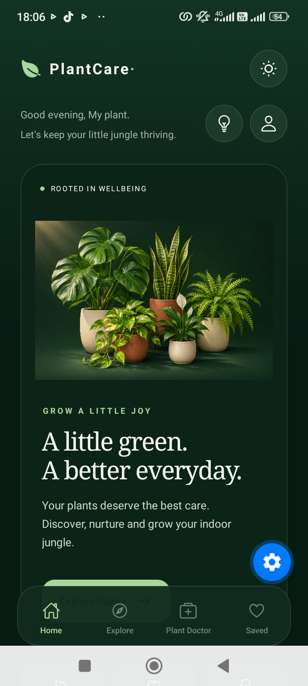</a><br>Home - dark mode</td>
    <td align="center" valign="top"><a href="assets/screenshots/home-light.jpeg">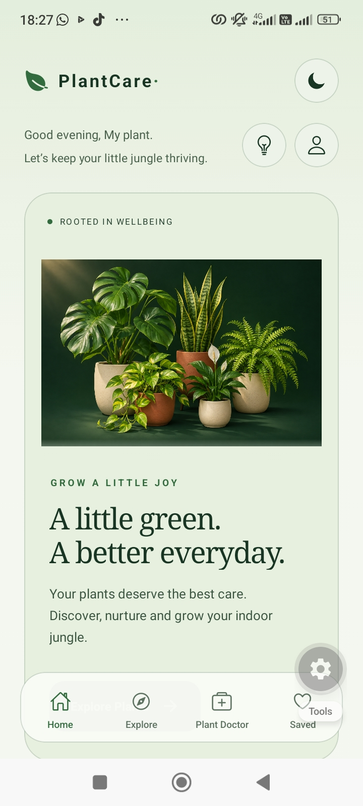</a><br>Home - light mode</td>
  </tr>
</table>

### Home shortcuts

<table>
  <tr>
    <td align="center" valign="top"><a href="assets/screenshots/home-featured.jpeg">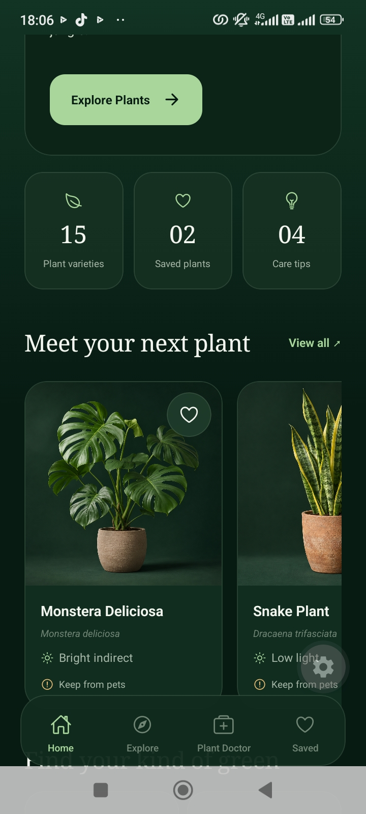</a><br>Featured plants and collection counts</td>
    <td align="center" valign="top"><a href="assets/screenshots/home-categories.jpeg">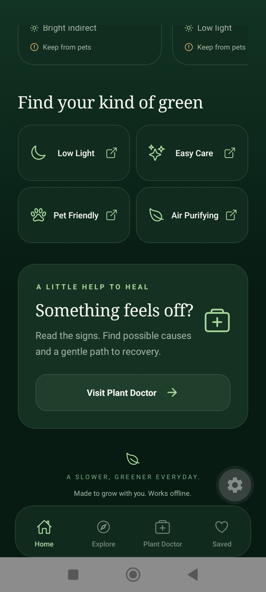</a><br>Plant categories and Plant Doctor shortcut</td>
  </tr>
</table>

### Explore and filters

<table>
  <tr>
    <td align="center" valign="top"><a href="assets/screenshots/explore-low-light.jpeg">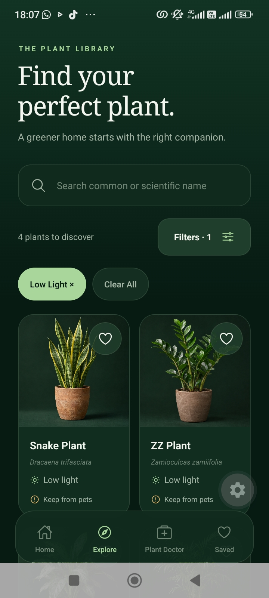</a><br>Explore with the Low Light filter</td>
    <td align="center" valign="top"><a href="assets/screenshots/explore-filters.jpeg">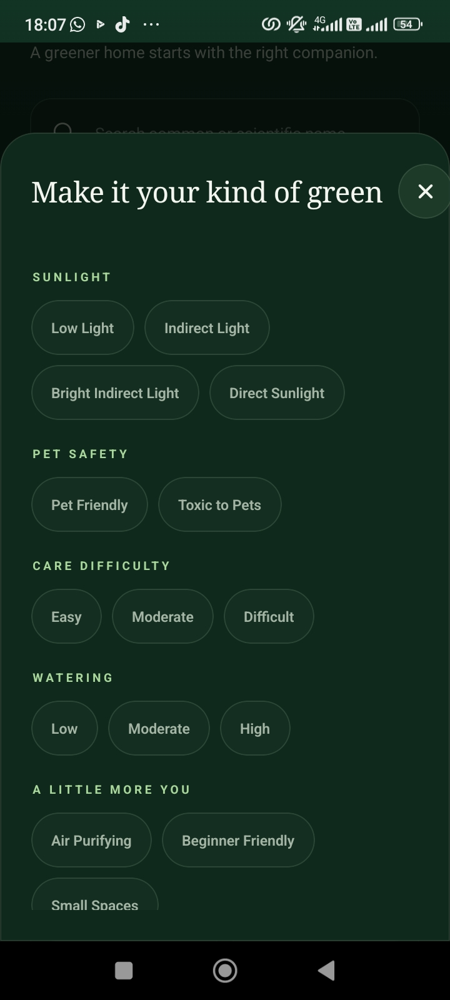</a><br>Care and category filter options</td>
    <td align="center" valign="top"><a href="assets/screenshots/explore-search.jpeg">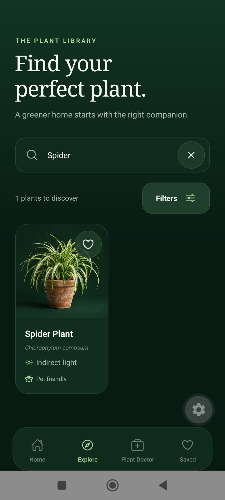</a><br>Search results for Spider Plant</td>
  </tr>
</table>

### Plant Doctor

<table>
  <tr>
    <td align="center" valign="top"><a href="assets/screenshots/doctor-symptoms.jpeg">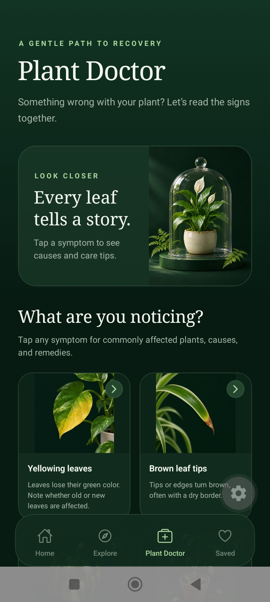</a><br>Plant Doctor symptom selection</td>
    <td align="center" valign="top"><a href="assets/screenshots/doctor-matches.jpeg">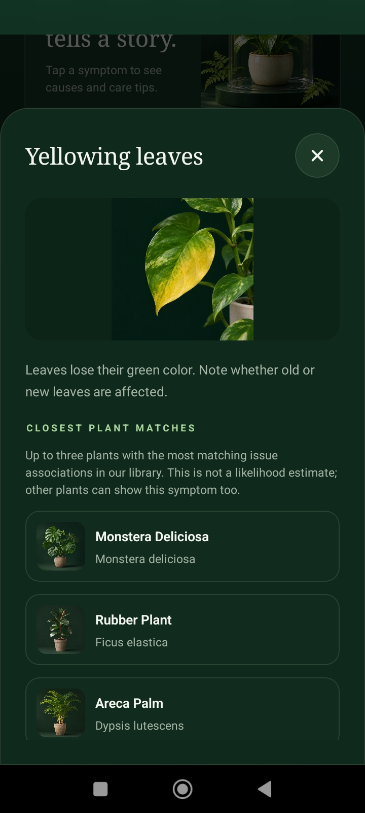</a><br>Yellowing leaves and closest plant matches</td>
    <td align="center" valign="top"><a href="assets/screenshots/doctor-care-guide.jpeg">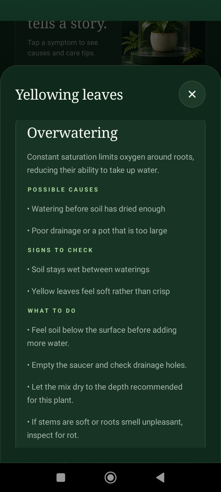</a><br>Possible causes, signs, and recovery steps</td>
  </tr>
</table>

### Saved plants, profile, and care tips

<table>
  <tr>
    <td align="center" valign="top"><a href="assets/screenshots/saved-plants.jpeg">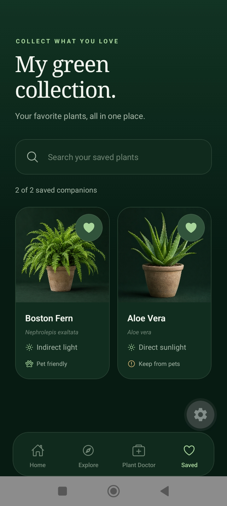</a><br>Saved plant collection</td>
    <td align="center" valign="top"><a href="assets/screenshots/profile.jpeg">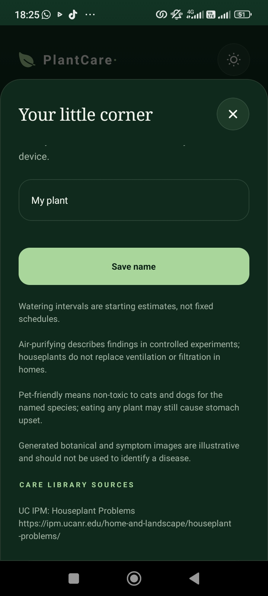</a><br>Profile name and care library sources</td>
    <td align="center" valign="top"><a href="assets/screenshots/care-tips.jpeg">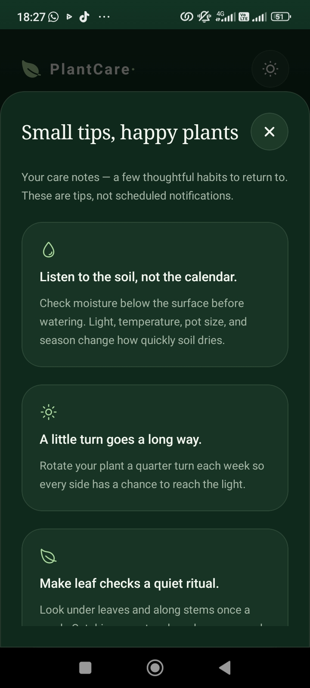</a><br>Everyday plant care tips</td>
  </tr>
</table>

## Built with

- Expo SDK 58 and React Native
- JavaScript, React, and Expo Router
- AsyncStorage for local preferences and favourites
- Local JSON datasets and bundled PNG images
- ESLint, Prettier, and a TypeScript-based project check

## Getting started

Install Node.js and npm, and open a terminal in the project folder:

```bash
cd Plant_Care
npm install
npx expo start
```

Skip `cd Plant_Care` if your terminal is already in the repository. Follow the terminal instructions to open the app with a compatible Expo Go version or an emulator. When using a physical phone, keep the phone and computer on the same Wi-Fi network.

## Project structure

```text
assets/
  illustrations/       Illustrations and sun/moon theme icons
  plants/              Plant images
  symptoms/            Symptom illustrations
  screenshots/         App screenshots used in this README
src/
  app/                 Expo Router screens and navigation layouts
    (tabs)/            Home, Explore, Plant Doctor, and Saved
    plant/[id].jsx     Plant Details route
  components/          Shared UI, cards, storage notices, and theme toggle
  constants/
    theme.js           Dark/light palettes, fonts, and filter options
    uiStyles.js        Shared styles created from the selected palette
    images.js          Bundled image references
  data/                Plants, symptoms, issues, care tips, and sources
  hooks/               Favourites, profile preferences, and theme state
  services/            Dataset helpers and favourites storage
  utils/               Plant search/filter logic
```
